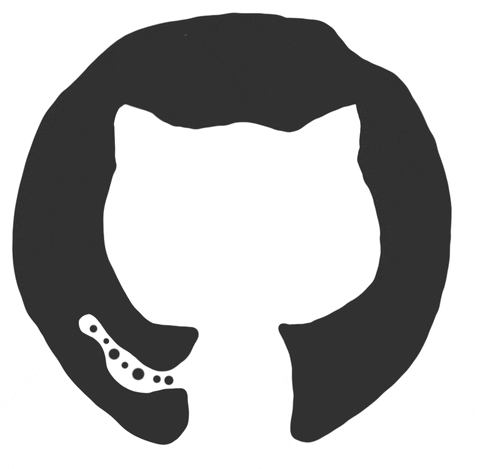

 

## Contributions to Open Source Projects

### [JuliusBrussee/caveman](https://github.com/JuliusBrussee/caveman) ⭐ 116k

- [`ce97a19`](https://github.com/JuliusBrussee/caveman/commit/ce97a19d241a0908fde4d45e8d80736f29f1abc3) feat(evals): measure per-turn reminder, old vs new
- [`43bbefc`](https://github.com/JuliusBrussee/caveman/commit/43bbefc2c2c77f2efbb53f12958ef49a8ea31a12) fix(hooks): per-turn reminder limit answer scope, not only wording

<!-- <h2 align="left"> Github Stats</h2> -->

<!-- 
 -->

<!-- Jokes: https://github.com/ABSphreak/readme-jokes -->
<h2 align="left"> Dad Joke</h2>

